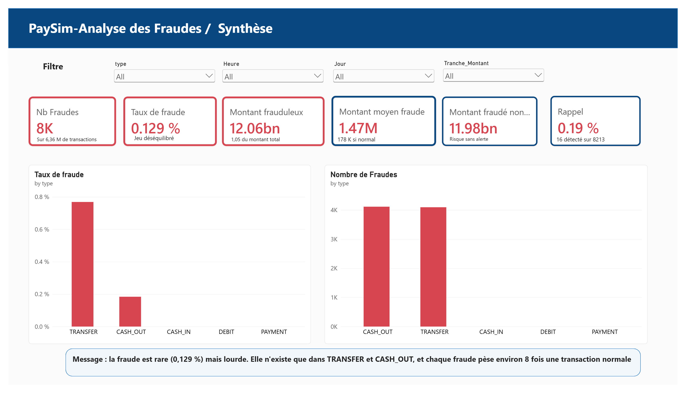
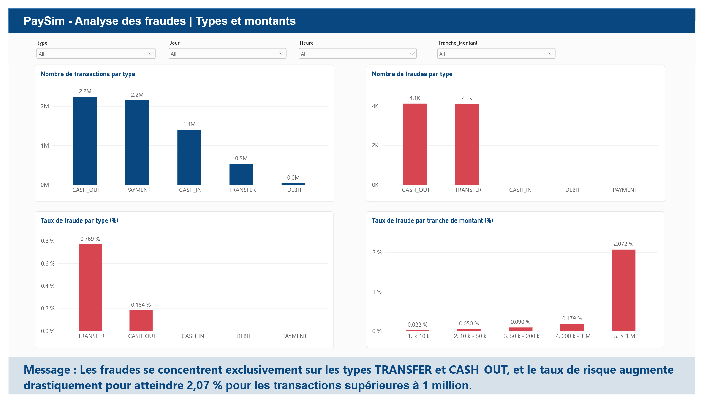
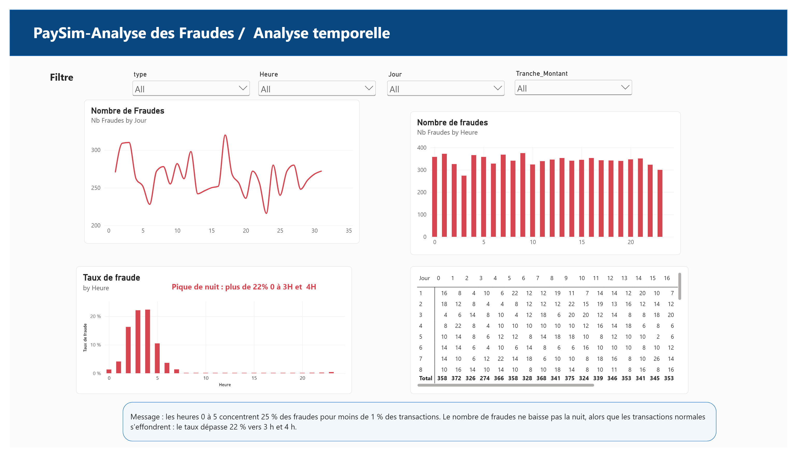

# 💳 PaySim Fraud Analysis
### Analyse des transactions financières et détection des comportements frauduleux avec Power BI


---

## 📖 Contexte du projet

Le développement des services de **Mobile Money** a profondément transformé les usages financiers en facilitant les paiements, les transferts d'argent et les retraits de fonds. Cependant, cette démocratisation s'accompagne d'une augmentation des risques de fraude, nécessitant des mécanismes de surveillance et de détection toujours plus performants.

Ce projet s'appuie sur le dataset **PaySim**, un ensemble de données synthétiques reproduisant des transactions financières réelles sur 31 jours, afin d'étudier les comportements frauduleux et d'évaluer l'efficacité d'un système d'alerte automatisé basé sur des règles métiers.

---

## 🎯 Public Cible

Ce rapport et ce tableau de bord s'adressent particulièrement aux :
- **Établissements financiers et opérateurs de Mobile Money :** pour identifier les failles d'alerte actuelles et optimiser la sécurité des transactions.
- **Équipes de sécurité et de lutte contre la fraude (AML/Fraud Risk) :** pour calibrer de nouvelles règles métier basées sur le comportement temporel et les montants.
- **Analystes de données et décideurs stratégiques :** pour visualiser l'impact financier de la fraude et orienter les investissements technologiques.

---

## 🎯 Objectifs

Les objectifs principaux sont :
- Mesurer l'ampleur réelle de la fraude sur l'ensemble du dataset (6,36 M de transactions).
- Identifier les typologies d'opérations et tranches de montants les plus exposées au risque.
- Analyser les tendances temporelles (journalières et horaires) des activités malveillantes.
- Évaluer rigoureusement la performance du système de détection automatisé existant (règle des 200 000).
- Produire un tableau de bord décisionnel interactif et standardisé sous Power BI.

---

## ❓ Questions Business

1. **Ampleur de la fraude**
   - Quelle est la proportion de transactions frauduleuses ?
   - Quelle valeur financière représente cette fraude par rapport au volume total échangé ?

2. **Typologie des fraudes**
   - Quels types de transactions sont principalement ciblés ?
   - Quels montants et tranches financières sont impliqués dans les activités frauduleuses ?

3. **Analyse temporelle**
   - Existe-t-il des pics ou des tendances dans la survenance des fraudes au cours du mois ?
   - Certains créneaux horaires présentent-ils un taux de risque disproportionné ?

4. **Performance du système d'alerte**
   - La règle métier actuelle (signalement des transferts $> 200\text{ k}$) permet-elle d'identifier efficacement les fraudes ?
   - Quel est son niveau de faux positifs (FP), de faux négatifs (FN) et quel est le montant total non détecté ?

---

## 📊 Présentation des données

### Source
Dataset **PaySim** officiel disponible sur Kaggle : [Synthetic Financial Datasets for Fraud Detection](https://www.kaggle.com/datasets/ealaxi/paysim1).

### Description

| Élément | Valeur |
| :--- | :--- |
| **Nombre de lignes** | 6 362 620 |
| **Nombre de colonnes** | 11 (8 dans la version allégée Power BI) |
| **Période simulée** | 743 pas de temps (31 jours, jour 31 incomplet) |
| **Type de données** | Transactions financières synthétiques Mobile Money |

### Variables principales conservées

| Variable | Description |
| :--- | :--- |
| `step` | Unité de temps ($1\text{ step} = 1\text{ heure}$, de 1 à 743) |
| `type` | Type de transaction (`CASH_IN`, `CASH_OUT`, `DEBIT`, `PAYMENT`, `TRANSFER`) |
| `amount` | Montant de la transaction en monnaie locale |
| `isFraud` | Indicateur de fraude réelle (1 = Fraude, 0 = Normale) |
| `isFlaggedFraud` | Alerte générée par le système actuel (1 = Alerte, 0 = Non alerte) |
| `Jour` | Colonne calculée : jour du mois (1 à 31) |
| `Heure` | Colonne calculée : heure de la journée (0 à 23) |
| `Tranche_Montant` | Segmentation par tranche (`< 10 k`, `10 k-50 k`, `50 k-200 k`, `200 k-1 M`, `> 1 M`) |

---

## 🧠 Méthodologie

### CRISP-DM
1. **Compréhension métier :** Définition de la problématique d'évaluation du système d'alerte et des 4 axes.
2. **Compréhension des données :** Exploration du CSV complet (6,36 M lignes, 0 valeur manquante, 0 doublon).
3. **Préparation des données :** Nettoyage Power Query M, typage `en-US`, suppression des colonnes lourdes de soldes/comptes.
4. **Analyse & Modélisation :** Construction du modèle sémantique et implémentation des mesures DAX.
5. **Évaluation :** Matrice de confusion ($VP$, $FN$, $FP$, $VN$), Rappel, Précision, Score F1.
6. **Restitution :** Rapport Power BI interactif de 5 pages et documentation technique.

### Scrumban
La gestion de projet s'appuie sur un sprint unique de 4 jours piloté via un tableau Kanban (GitHub Projects), des points d'équipe quotidiens et une revue stricte par Pull Request.

---

## 🏗️ Architecture Power BI Project (.pbip)

Le projet est structuré au format **Power BI Project (.pbip)** pour permettre le versioning sous Git :

- **`sources_files/paysim_fraud_analysis.SemanticModel/`** : Contient le script Power Query M unifié, la définition des mesures DAX et les métadonnées TMDL.
- **`sources_files/paysim_fraud_analysis.Report/`** : Contient la disposition visuelle, les pages du rapport et la charte graphique JSON.

---

## 📈 Structure du Dashboard & Résultats Visuels

### 1. Vue d'ensemble & Synthèse
Visualisation globale de la fraude et des 6 indicateurs clés du projet.


### 2. Axes 1 & 2 : Ampleur, Types et Montants
Répartition des fraudes par type d'opération et analyse de l'explosion du risque selon les tranches de montant.


### 3. Axe 3 : Analyse Temporelle
Évolution du volume de fraudes par jour et mise en évidence du pic de risque nocturne (heures 0 à 5).


### 4. Axe 4 : Évaluation du Système d'Alerte
Matrice de confusion et analyse du décalage massif entre fraudes réelles et transactions signalées.


---

## 🔍 Principaux Insights

- **Concentration exclusive :** Les 8 213 fraudes répertoriées surviennent **exclusivement** sur deux types d'opérations : `CASH_OUT` (4 116) et `TRANSFER` (4 097). Les types `CASH_IN`, `PAYMENT` et `DEBIT` ne présentent aucune fraude (0 %).
- **Inefficacité critique du système d'alerte :** La règle actuelle ne détecte que 16 fraudes sur 8 213, soit un **Rappel de 0,19 %**. Bien que la précision soit de 100 % (aucun faux positif), **11,98 milliards** de montants frauduleux restent non détectés (contre 78 M signalés).
- **Explosion du risque la nuit :** Bien que le nombre de fraudes soit constant tout au long de la journée (~340 par heure), l'effondrement des transactions normales la nuit fait s'envoler le taux de fraude à plus de **22 % entre 3h et 4h du matin**. Les heures 0 à 5 concentrent 25 % des fraudes pour moins de 1 % du volume total.
- **Risque sur les hauts montants :** Le taux de fraude passe de **0,02 %** pour les montants inférieurs à $10\text{ k}$ à **2,07 %** pour les montants supérieurs à $1\text{ M}$ (soit un risque 100 fois plus élevé).

---

## 💡 Recommandations Métier

1. **Refonte et élargissement des règles métier :** Étendre immédiatement les règles d'alerte aux retraits `CASH_OUT` (qui représentent 50 % des fraudes et ne sont aucunement surveillés) et abaisser le seuil sur les `TRANSFER` sous les $200\text{ k}$.
2. **Surveillance horaire renforcée (0h - 5h) :** Imposer une authentification forte (2FA) ou un blocage temporaire automatique des gros transferts nocturnes.
3. **Seuils progressifs selon le montant :** Abaisser les filtres de contrôle dès que les montants dépassent $200\text{ k}$ et imposer un contrôle d'agent sur les transactions $> 1\text{ M}$.

---

## ⚠️ Limites du Projet

- **Dataset synthétique :** Données produites par la simulation PaySim (résultats illustratifs de mécanismes).
- **Jour 31 incomplet :** Le pas de temps s'arrête à 743 (23 heures au lieu de 24 pour le dernier jour).
- **Soldes non exploités :** Environ 80 % des lignes présentent des soldes incohérents en raison de l'annulation des fraudes détectées dans la simulation, justifiant leur retrait du modèle d'analyse.

---

# 🚀 Reproduire le Projet

## Prérequis
- **Windows 10 / 11** *(Power BI Desktop s'exécute nativement sous Windows)*.
- **Power BI Desktop** (dernière version supportant le format `.pbip`).
- **Git** & **VS Code**.

## Configuration du Jeu de Données
1. Téléchargez le dataset `PS_20174392719_1491204439457_log.csv` sur [Kaggle](https://www.kaggle.com/datasets/ealaxi/paysim1).
2. Créez le dossier `C:\PaySim\` sous Windows.
3. Placez le fichier CSV dans : `C:\PaySim\PS_20174392719_1491204439457_log.csv`.

## Cloner et Ouvrir le Dépôt
```bash
git clone https://github.com/grace-moussoni/PaySim-Fraud-Analysis.git
cd PaySim-Fraud-Analysis
```
Ouvrez le fichier projet dans Power BI Desktop :
```text
sources_files/paysim_fraud_analysis.pbip
```

---

## 👥 Équipe Projet — Groupe 3 (Akieny Academy)

| Membre | Rôle |
| :--- | :--- |
| **Rosy Perine NGOMA IKAMA** | Cheffe de Projet / Lead Data |
| **MOUSSONI Grace** | Repository Administrator |
| **Christ Roland BIBILA-MANGAYI** | Data Analyst (Axes 1 & 2) |
| **Marthinet Berthanie de Sagesse** | Data Analyst (Axe 3) |
| **MBANDOU Sublime** | Data Analyst & Visualisation (Axe 4 & Dashboard) |

---

## 📜 Licence & Remerciements

Projet sous licence **MIT**. Voir le fichier [LICENSE](LICENSE) pour plus de détails.  
Remerciements à **Akieny Academy**, **Kaggle** et **Edgar Lopez-Rojas** pour la mise à disposition du dataset PaySim.